<!-- generated by scripts/build.mjs — do not edit by hand -->

<picture><source media="(prefers-color-scheme: dark)" srcset="./assets/banner-dark.svg"></picture>

  
  
  
  

<picture><source media="(prefers-color-scheme: dark)" srcset="./assets/divider-products-dark.svg"></picture>

Complete, self-hostable SaaS products — each with an admin panel, plans & payments, full
documentation and a **live demo**. MIT licensed: use them, fork them, run them for your clients.

<table>
<tr>
<td width="50%" valign="top"><a href="https://github.com/epifive/statuszen"><picture><source media="(prefers-color-scheme: dark)" srcset="./assets/card-statuszen-dark.svg"></picture></a> <a href="https://statuszen.vercel.app">Live demo</a> · <a href="https://www.epifive.com/blog/statuszen-open-source-uptime-monitor-status-page">Guide</a> · <a href="https://github.com/epifive/statuszen">Code</a></td>
<td width="50%" valign="top"><a href="https://github.com/epifive/pulsezen"><picture><source media="(prefers-color-scheme: dark)" srcset="./assets/card-pulsezen-dark.svg"></picture></a> <a href="https://pulsezen-iota.vercel.app">Live demo</a> · <a href="https://www.epifive.com/blog/pulsezen-self-hosted-google-analytics-alternative">Guide</a> · <a href="https://github.com/epifive/pulsezen">Code</a></td>
</tr>
<tr>
<td width="50%" valign="top"><a href="https://github.com/epifive/trustzen"><picture><source media="(prefers-color-scheme: dark)" srcset="./assets/card-trustzen-dark.svg"></picture></a> <a href="https://trustzen-eight.vercel.app">Live demo</a> · <a href="https://www.epifive.com/blog/trustzen-open-source-testimonial-widget">Guide</a> · <a href="https://github.com/epifive/trustzen">Code</a></td>
<td width="50%" valign="top"><a href="https://github.com/epifive/referzen"><picture><source media="(prefers-color-scheme: dark)" srcset="./assets/card-referzen-dark.svg"></picture></a> <a href="https://referzen-demo.vercel.app">Live demo</a> · <a href="https://www.epifive.com/blog/referzen-open-source-affiliate-software">Guide</a> · <a href="https://github.com/epifive/referzen">Code</a></td>
</tr>
<tr>
<td width="50%" valign="top"><a href="https://github.com/epifive/searchzen"><picture><source media="(prefers-color-scheme: dark)" srcset="./assets/card-searchzen-dark.svg"></picture></a> <a href="https://searchzen-demo.vercel.app">Live demo</a> · <a href="https://www.epifive.com/blog/searchzen-self-hosted-seo-rank-tracker">Guide</a> · <a href="https://github.com/epifive/searchzen">Code</a></td>
<td width="50%" valign="top"><a href="https://github.com/epifive/queuezen"><picture><source media="(prefers-color-scheme: dark)" srcset="./assets/card-queuezen-dark.svg"></picture></a> <a href="https://queuezen-demo.vercel.app">Live demo</a> · <a href="https://www.epifive.com/blog/queuezen-open-source-social-media-scheduler">Guide</a> · <a href="https://github.com/epifive/queuezen">Code</a></td>
</tr>
<tr>
<td width="50%" valign="top"><a href="https://github.com/epifive/dialzen"><picture><source media="(prefers-color-scheme: dark)" srcset="./assets/card-dialzen-dark.svg"></picture></a> <a href="https://dialzen-demo.vercel.app">Live demo</a> · <a href="https://www.epifive.com/blog/dialzen-open-source-ai-voice-agent">Guide</a> · <a href="https://github.com/epifive/dialzen">Code</a></td>
<td width="50%" valign="top"><a href="https://github.com/epifive/whatsapp-crm"><picture><source media="(prefers-color-scheme: dark)" srcset="./assets/card-whatsapp-crm-dark.svg"></picture></a> <a href="https://crm-for-whatsapp-demo.vercel.app">Live demo</a> · <a href="https://www.epifive.com/blog/crm-for-whatsapp-open-source-whatsapp-crm">Guide</a> · <a href="https://github.com/epifive/whatsapp-crm">Code</a></td>
</tr>
<tr>
<td width="50%" valign="top"><a href="https://github.com/epifive/toolzen"><picture><source media="(prefers-color-scheme: dark)" srcset="./assets/card-toolzen-dark.svg"></picture></a> <a href="https://toolzen-sand.vercel.app">Live demo</a> · <a href="https://www.epifive.com/blog/toolzen-open-source-online-tools-website-script">Guide</a> · <a href="https://github.com/epifive/toolzen">Code</a></td>
</tr>
</table>

<picture><source media="(prefers-color-scheme: dark)" srcset="./assets/divider-resources-dark.svg"></picture>

<table>
<tr>
<td width="50%" valign="top"><a href="https://github.com/epifive/it-cheatsheets"><picture><source media="(prefers-color-scheme: dark)" srcset="./assets/card-it-cheatsheets-dark.svg"></picture></a> <a href="https://github.com/epifive/it-cheatsheets">Repository</a></td>
<td width="50%" valign="top"><a href="https://github.com/epifive/azure-vm-prices"><picture><source media="(prefers-color-scheme: dark)" srcset="./assets/card-azure-vm-prices-dark.svg"></picture></a> <a href="https://github.com/epifive/azure-vm-prices">Repository</a></td>
</tr>
<tr>
<td width="50%" valign="top"><a href="https://github.com/epifive/m365-azure-checklists"><picture><source media="(prefers-color-scheme: dark)" srcset="./assets/card-m365-azure-checklists-dark.svg"></picture></a> <a href="https://github.com/epifive/m365-azure-checklists">Repository</a></td>
</tr>
</table>
<!-- end generated -->

### What you get

| | |
| --- | --- |
| **Web installer** | Connect the database (MySQL/MariaDB or SQLite; PostgreSQL for CRM for WhatsApp) and install from the browser. |
| **Admin panel** | Users, plans, payments, settings and more. |
| **Runs anywhere** | VPS, Docker, PM2, Node.js hosting or Vercel. |
| **Documentation** | A full user and admin guide in every repository. |
| **Live demo** | Try every product before you install it. |

### Built with

  
  
  
  
  
  
  
  
  

### Need it hosted, installed or customised?

EpiFive can host these products for you, install them on your own server or build custom
features on top. **[Talk to EpiFive →](https://www.epifive.com/services#custom-app-development)**

### Contributing

Issues and pull requests are welcome on every repository. If a project helps you, a ⭐ helps
others find it.

Cards and stats on this page are rebuilt daily by a small script in
[`epifive/.github`](https://github.com/epifive/.github).
