<!-- generated by scripts/build.mjs — do not edit by hand -->

<picture><source media="(prefers-color-scheme: dark)" srcset="./assets/hero-dark.svg"></picture>

  
  
  
  

<picture><source media="(prefers-color-scheme: dark)" srcset="./assets/h-products-dark.svg"></picture>

<table>
<tr>
<td width="50%" valign="top" align="center">
<a href="https://github.com/epifive/statuszen">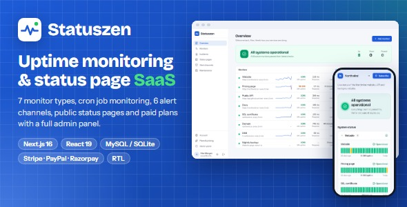</a>
 <b><a href="https://github.com/epifive/statuszen">Statuszen</a></b> · Uptime monitoring &amp; status pages
   
</td>
<td width="50%" valign="top" align="center">
<a href="https://github.com/epifive/pulsezen">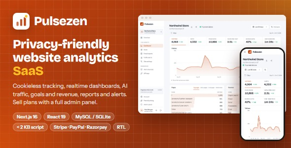</a>
 <b><a href="https://github.com/epifive/pulsezen">Pulsezen</a></b> · Cookieless web analytics
   
</td>
</tr>
<tr>
<td width="50%" valign="top" align="center">
<a href="https://github.com/epifive/dialzen">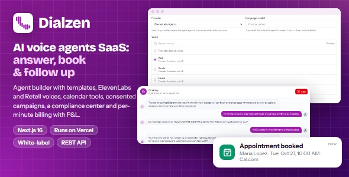</a>
 <b><a href="https://github.com/epifive/dialzen">Dialzen</a></b> · AI voice agents
   
</td>
<td width="50%" valign="top" align="center">
<a href="https://github.com/epifive/queuezen">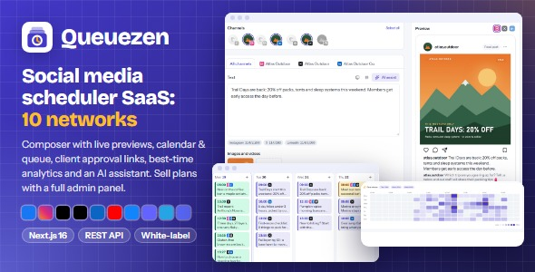</a>
 <b><a href="https://github.com/epifive/queuezen">Queuezen</a></b> · Social media scheduler
   
</td>
</tr>
<tr>
<td width="50%" valign="top" align="center">

 <b><a href="https://github.com/epifive/whatsapp-crm">CRM for WhatsApp</a></b> · Team inbox, campaigns &amp; chatbots
   
</td>
<td width="50%" valign="top" align="center">
<a href="https://github.com/epifive/searchzen">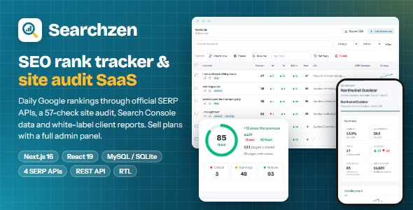</a>
 <b><a href="https://github.com/epifive/searchzen">Searchzen</a></b> · SEO rank tracker &amp; site audit
   
</td>
</tr>
<tr>
<td width="50%" valign="top" align="center">
<a href="https://github.com/epifive/trustzen">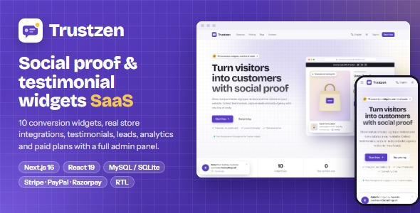</a>
 <b><a href="https://github.com/epifive/trustzen">Trustzen</a></b> · Social proof &amp; testimonial widgets
   
</td>
<td width="50%" valign="top" align="center">

 <b><a href="https://github.com/epifive/referzen">Referzen</a></b> · Affiliate &amp; referral programs
   
</td>
</tr>
<tr>
<td width="50%" valign="top" align="center">
<a href="https://github.com/epifive/toolzen">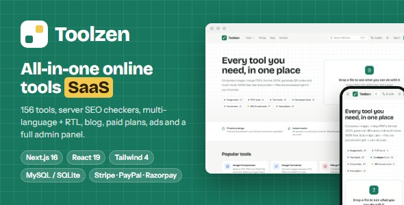</a>
 <b><a href="https://github.com/epifive/toolzen">Toolzen</a></b> · 156 online tools website
   
</td>
<td width="50%"></td>
</tr>
</table>

<picture><source media="(prefers-color-scheme: dark)" srcset="./assets/h-mini-dark.svg"></picture>

<table><tr><td width="33%" valign="top"><a href="https://github.com/epifive/gst-invoice"><picture><source media="(prefers-color-scheme: dark)" srcset="./assets/card-gst-invoice-dark.svg"></picture></a> <a href="https://gst-invoice-demo.pages.dev">Live demo</a> · <a href="https://github.com/epifive/gst-invoice">Free (MIT)</a> · <a href="https://www.epifive.com/products/gst-invoice-pro"><b>Get Pro</b></a></td><td width="33%" valign="top"><a href="https://github.com/epifive/qr-code-generator"><picture><source media="(prefers-color-scheme: dark)" srcset="./assets/card-qr-code-generator-dark.svg"></picture></a> <a href="https://qr-code-generator-demo.pages.dev">Live demo</a> · <a href="https://github.com/epifive/qr-code-generator">Free (MIT)</a> · <a href="https://www.epifive.com/products/qr-code-generator-pro"><b>Get Pro</b></a></td></tr></table>

<picture><source media="(prefers-color-scheme: dark)" srcset="./assets/h-install-dark.svg"></picture>

<picture><source media="(prefers-color-scheme: dark)" srcset="./assets/terminal-dark.svg"></picture>

<picture><source media="(prefers-color-scheme: dark)" srcset="./assets/h-resources-dark.svg"></picture>

<table>
<tr>
<td width="33%" valign="top"><a href="https://github.com/epifive/it-cheatsheets"><picture><source media="(prefers-color-scheme: dark)" srcset="./assets/card-it-cheatsheets-dark.svg"></picture></a></td>
<td width="33%" valign="top"><a href="https://github.com/epifive/azure-vm-prices"><picture><source media="(prefers-color-scheme: dark)" srcset="./assets/card-azure-vm-prices-dark.svg"></picture></a></td>
<td width="33%" valign="top"><a href="https://github.com/epifive/m365-azure-checklists"><picture><source media="(prefers-color-scheme: dark)" srcset="./assets/card-m365-azure-checklists-dark.svg"></picture></a></td>
</tr>
</table>
<!-- end generated -->

### What you get with every product

<table>
<tr>
<td width="33%" valign="top"><b>🧩 Web installer</b> Connect MySQL/MariaDB or SQLite (PostgreSQL for CRM for WhatsApp) and install from the browser.</td>
<td width="33%" valign="top"><b>🛠️ Admin panel</b> Users, plans, payments, settings and more — ready to run as a SaaS.</td>
<td width="33%" valign="top"><b>🚀 Runs anywhere</b> VPS, Docker, PM2, Node.js hosting or Vercel.</td>
</tr>
<tr>
<td valign="top"><b>📚 Full documentation</b> A user and admin guide in every repository.</td>
<td valign="top"><b>🎯 Live demo</b> Try every product before you install it.</td>
<td valign="top"><b>⚖️ MIT licence</b> Use it, fork it, run it for your clients.</td>
</tr>
</table>

### Built with

  
  
  
  
  
  
  
  
  

### Support the work

<table>
<tr>
<td width="50%" valign="top">
<b>☕ Like these projects?</b> 
Star the repos you use and <a href="https://buymeacoffee.com/epifive">buy us a coffee</a> — it keeps new products and updates coming.  

</td>
<td width="50%" valign="top">
<b>🤝 Need it hosted, installed or customised?</b> 
EpiFive can host these products for you, install them on your own server or build custom features on top.  

</td>
</tr>
</table>

Issues and pull requests are welcome on every repository · this page is rebuilt daily by
<a href="https://github.com/epifive/.github">scripts/build.mjs</a>

